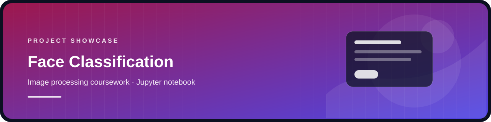

  
  <h1>Face Classification — Image Processing Coursework</h1>
  

  
Coursework notebook for a face-image classification exercise.

## Included

- `face_classification.ipynb` — notebook with the code cells preserved and cell outputs cleared.

## Data and privacy

The source folder contained face photographs of the project owner and other people. Those images and the coursework report are excluded from this public repository. Add a locally held, consented dataset under `faces_db/` if you want to rerun the notebook; the folder is ignored by Git.

Before publishing any new sample images, obtain permission from the people shown. The notebook outputs were cleared so saved face images are not embedded in the notebook.

## Open

Open `face_classification.ipynb` in Jupyter Notebook or JupyterLab. The data files are not included, so the notebook needs an appropriate local dataset before it can run end to end.
